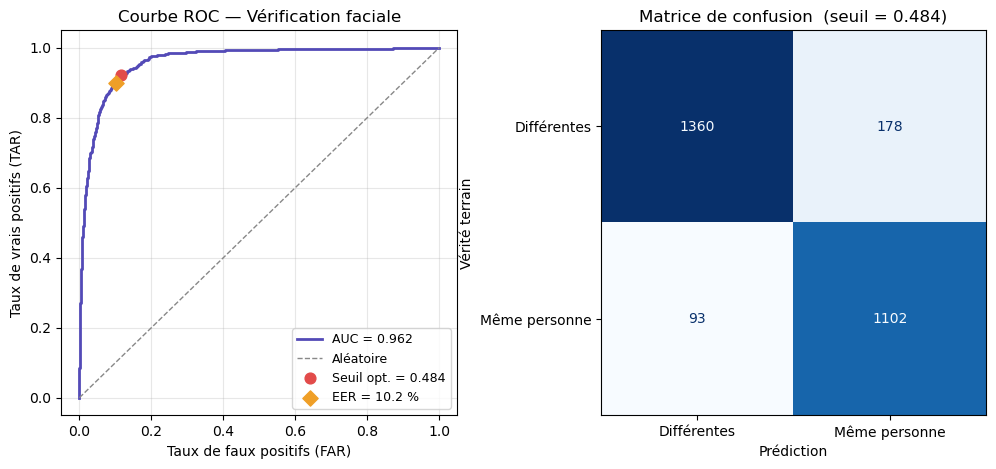

# Face Verification & Identification with a Residual CNN and Batch-Hard Triplet Loss

A face recognition pipeline built from scratch with TensorFlow/Keras. A residual CNN maps each face to a
128-dimensional embedding; two faces are compared with the cosine distance. The network is trained with a
**Batch-Hard Triplet Loss** on the LFW dataset.



## Results

Face **verification** ("are these two images the same person?") on 2,733 random image pairs drawn from the held-out test split:

| Metric | Value |
| --- | --- |
| AUC | **0.962** |
| Accuracy | **90.08 %** |
| Precision / Recall | 86.09 % / 92.22 % |
| F1-score | 0.8905 |
| EER | 10.21 % |
| TAR @ FAR = 1 % | 48.54 % |
| Decision threshold (cosine distance) | 0.484 |

Pairs are sampled randomly, so AUC varies slightly between runs (0.960 – 0.962 in my runs).

Example (from the notebook): two photos of the same person → distance `0.143` (same person);
two different people → distance `0.676` (different people).

## How it works

- **Data:** [LFW](http://vis-www.cs.umass.edu/lfw/) (deep-funneled). Only identities with ≥ 5 images are kept:
  **5,985 images, 423 identities**. Images are converted to grayscale, resized to 96×96 and standardized.
- **Split:** 80 % train / 20 % test (stratified by identity label).
- **Sampling:** class-balanced batches of P = 16 identities × K = 4 images (batch size 64).
- **Augmentation:** random horizontal flip + Gaussian noise.
- **Model:** convolutional stem (32 filters) → 6 residual blocks (32, 32, 64, 64, 128, 128) with max-pooling
  between stages → global average pooling → Dense(128) + BatchNorm + ReLU + Dropout(0.3) → **L2-normalized embedding**.
- **Loss:** Batch-Hard Triplet Loss (hardest positive / hardest negative in each batch), margin 0.3.
- **Optimization:** Adam, cosine learning-rate decay from 1e-3, up to 100 epochs, early stopping (patience 20).
- **Inference:** `verify(img_a, img_b, threshold)` compares two images; `identify(img, gallery, threshold)`
  returns the closest identity in a gallery built with `build_gallery(...)`.

## Run it

```bash
pip install -r requirements.txt
```

1. Download the LFW (deep-funneled) images and place them in `./lfw_dataset/lfw-deepfunneled/lfw-deepfunneled/`
   (the dataset is **not** included in this repository).
2. Open `face_recognition.ipynb` and run the cells from top to bottom.
   The notebook also saves `roc_curve.png`, `evaluation_complete.png` and `best_weights.weights.h5`.

## Limitations (and what I would improve next)

- **Evaluation protocol.** The test split contains *new images of identities that were also seen during training*,
  and the decision threshold is selected on the test pairs. The numbers above are therefore optimistic and are
  **not comparable** to the official LFW benchmark. A stricter evaluation would split by identity
  (unseen people in the test set) and choose the threshold on a separate validation set.
- **Input quality.** Grayscale 96×96 inputs and a small network limit accuracy compared with state-of-the-art models.
- **Domain shift.** The model is trained on LFW press photos; images with a very different look (screenshots,
  other lighting or cameras) are not reliably handled.
- **Identification.** `identify` always returns the nearest identity in the gallery; an "unknown person"
  rejection rule based on the threshold would make it more robust.

## Tech stack

Python · TensorFlow · Keras · NumPy · pandas · scikit-learn · Pillow · Matplotlib
